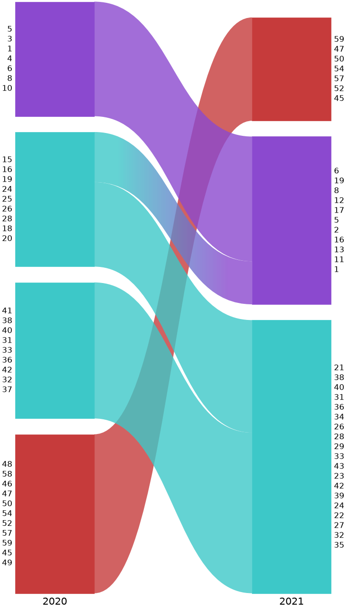

# alluvial

Alluvial diagrams of [Infomap](https://www.mapequation.org/infomap/) partitions for matplotlib, for scientific
papers. The layout is a faithful port of the engine behind the
[mapequation.org alluvial web app](https://www.mapequation.org/alluvial/), so module order, sizes, margins,
streamlines and colours match the web app, while the figures are ordinary matplotlib artists you can place on any
axes and save as vector PDF or SVG.

## Install

```sh
pip install alluvial
pip install "alluvial[infomap]"  # to pass infomap.Infomap objects directly
```

Requires Python >= 3.11 and matplotlib >= 3.7. Files written by any infomap version (`.tree`, `.ftree`, `.clu`,
`*_states.*`, `.json`) read without the `infomap` extra.

## Quick start

```python
import random

import infomap

import alluvial


def run_infomap(groups, seed):
    """Infomap on a random graph with dense groups of nodes."""
    rng = random.Random(seed)
    group_of = {n: g for g, members in enumerate(groups) for n in members}
    im = infomap.Infomap(two_level=True, seed=123, silent=True)
    for u in group_of:
        for v in group_of:
            if u < v and rng.random() < (0.4 if group_of[u] == group_of[v] else 0.02):
                im.add_link(u, v)
    im.run()
    return im


im_2020 = run_infomap([range(15), range(15, 30), range(30, 45), range(45, 60)], seed=2020)
im_2021 = run_infomap([range(20), range(20, 45), range(45, 60)], seed=2021)  # groups merge

ax = alluvial.plot([im_2020, im_2021], names=["2020", "2021"])
ax.figure.savefig("alluvial.png", dpi=150)
```



Networks go from left to right, and each one can be a path to an Infomap output file (`.tree`, `.ftree`,
`.stree`, `.clu` or `-o json` `.json`), an `infomap.Infomap` that has run, an Infomap JSON dict, or an
{class}`alluvial.NetworkFile` from {func}`alluvial.read`.

```{toctree}
:maxdepth: 2

Tutorial <tutorial>
Capabilities <capabilities>
API reference <api>
Changelog <changelog>
```
